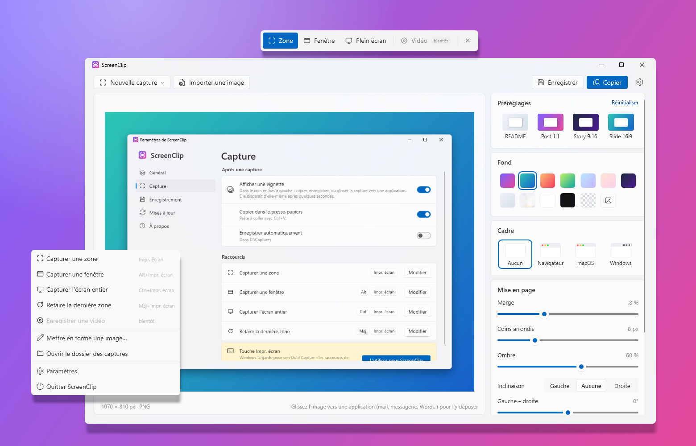

<p align="center">
  
</p>

<h1 align="center">ScreenClip</h1>

<p align="center">
  Des captures d'écran pour Windows 11, prêtes à partager : une touche, puis une jolie mise en forme autour (fond,
  cadre de fenêtre, coins arrondis, ombre).
</p>

<p align="center">
  <a href="README.md">English</a> · <b>Français</b>
</p>

<p align="center">
  
</p>

---

> **Début du développement.** La version 0.1 capture et met en forme les captures d'écran. Les annotations et la
> capture vidéo viendront ensuite.

## Fonctionnalités

### Capture

- **Impr. écran** capture une zone, **Alt + Impr. écran** une fenêtre, **Ctrl + Impr. écran** l'écran entier,
  **Maj + Impr. écran** refait la dernière zone. Chaque raccourci se modifie dans **Paramètres → Capture**.
- ScreenClip attend dans la **zone de notification** (son menu propose les mêmes captures, le dossier des captures et
  les paramètres). Au repos il ne consomme presque rien : aucune fenêtre, aucun minuteur, environ 5 Mo de mémoire
  utilisée.
- L'écran est **figé** à l'instant où la touche est pressée : menus et info-bulles restent sur l'image.
- **Zone** : glissez un rectangle ; un **clic** sans glisser prend la fenêtre sous le pointeur. Une **loupe** montre
  les pixels sous le pointeur (avec leur position et leur couleur), et la taille s'affiche pendant le tracé.
  **Maj** fait un carré, **Espace** déplace la zone, **clic droit** ou **Échap** recommence ou annule.
- **Fenêtre** : la fenêtre sous le pointeur est mise en évidence, un clic la prend.
- **Plein écran** : un clic prend l'écran sous le pointeur.
- Plusieurs écrans, chacun à sa propre échelle (100 %, 150 %…) : chaque pixel reste net.

### Éditeur de mise en forme

Lancé depuis le menu Démarrer, ScreenClip ouvre son **éditeur** : une capture (ou n'importe quelle image : **Importer
une image**, la coller avec **Ctrl+V**, la glisser sur la fenêtre) est mise en forme en direct, comme les captures des
pages de présentation d'applications et des posts de réseaux sociaux.

- Des **préréglages** en un clic : *README* (clair, discret), *Post 1:1*, *Story 9:16*, *Slide 16:9* ; **Réinitialiser**
  revient au préréglage README. Les derniers réglages utilisés sont gardés pour la capture suivante.
- **Fond** : huit dégradés, blanc, noir, transparent, la capture elle-même floutée, ou **votre propre image**.
- **Cadre** : aucun, un **navigateur façon macOS** (feux tricolores et une adresse que vous tapez), une **fenêtre
  macOS**, une **fenêtre Windows 11** (avec un titre que vous tapez), clair ou sombre ; ou un appareil, un
  **ordinateur portable** ou un **téléphone**, argent ou graphite (le téléphone se met à l'horizontale pour une capture
  large). Sans aucune marque.
- **Marge**, **coins arrondis** et **ombre** (curseurs), une **inclinaison 3D** (à gauche ou à droite en un clic, ou
  à la main : gauche–droite et haut–bas), et le **format** : auto, 16:9, 4:3, 1:1, 4:5 ou 9:16.
- La capture garde ses propres pixels : l'image grandit autour d'elle, rien n'est redimensionné. Les grandes captures
  (écrans haute densité) ont une barre de fenêtre et des coins plus grands, pour qu'un style rende pareil sur toutes.
- **Copier** (PNG avec sa transparence, et une image pour les autres applications), **Enregistrer** en PNG, JPG ou
  WebP, ou **glisser l'aperçu** vers une application ou un dossier.
- **Nouvelle capture** depuis l'éditeur : il s'efface le temps de choisir, et revient avec la capture.

### La touche Impr. écran de Windows

Windows 11 garde la touche **Impr. écran** pour son Outil Capture. Au premier lancement, ScreenClip propose de changer
ce réglage de Windows pour vous (*Paramètres › Accessibilité › Clavier › Utiliser la touche Impr. écran pour ouvrir
la capture d'écran*, pour votre compte seulement, sans droits d'administrateur). **Paramètres → Capture** permet de
rendre la touche à Windows à tout moment, et la désinstallation de ScreenClip la lui rend aussi. Windows n'applique
parfois le changement qu'à la prochaine ouverture de session.

### Après une capture

- Une **vignette** dans le coin en bas à gauche de l'écran (les notifications de Windows sont à droite) : **Copier**,
  **Enregistrer**, **Mettre en forme** (l'ouvre dans l'éditeur), l'**épingler** pour qu'elle reste, ou la **glisser**
  dans une application (mail,
  messagerie, Word, un dossier…), qui reçoit le fichier image. Elle disparaît d'elle-même après quelques secondes, ne
  prend jamais le clavier à l'application en cours et n'apparaît jamais dans les captures suivantes.
- La capture est **copiée** dans le presse-papiers (image et PNG), et peut être **enregistrée automatiquement** :
  fichiers PNG dans `Images\ScreenClip`, nommés `Capture 2026-10-19 à 18.12.05.png` (dossier et nom modifiables).

### Et aussi

- Apparence Windows 11 (Fluent, Mica) qui **suit le thème clair/sombre** de Windows ; le thème peut aussi être forcé
  dans les **Paramètres**.
- **Anglais et français**, selon la langue d'affichage de Windows ou au choix dans les **Paramètres**.
- **Démarre avec Windows** (désactivable dans les paramètres).
- **Mises à jour en un clic** : au démarrage, l'application consulte les Releases GitHub et propose la nouvelle
  version dans les paramètres, qui s'installe et relance l'application. Canal **Bêta** disponible.

### Raccourcis

| Action | Raccourci |
|--------|-----------|
| Capturer une zone | `Impr. écran` |
| Capturer une fenêtre | `Alt` + `Impr. écran` |
| Capturer l'écran entier | `Ctrl` + `Impr. écran` |
| Refaire la dernière zone | `Maj` + `Impr. écran` |
| Pendant la sélection : carré / déplacer / annuler | `Maj` / `Espace` / `Échap` ou clic droit |
| Éditeur : importer / coller / copier / enregistrer | `Ctrl+O` / `Ctrl+V` / `Ctrl+C` / `Ctrl+S` |

### À venir

- [x] Éditeur de mise en forme, fausses fenêtres, ordinateur portable et téléphone.
- [ ] Vos propres préréglages enregistrés.
- [ ] Annotations (flèches, texte, flou, étapes numérotées), capture vidéo / GIF.

## Installation

1. Téléchargez `ScreenClip-Setup-x.y.z.exe` depuis la page [Releases](../../releases).
2. Lancez-le. L'installeur n'étant pas signé, Windows SmartScreen peut afficher « Windows a protégé votre ordinateur » :
   cliquez sur **Informations complémentaires → Exécuter quand même**.
3. Acceptez la demande d'administrateur (UAC).

L'installeur :

- copie l'application dans `C:\Program Files\ScreenClip` et l'ajoute au menu Démarrer (raccourci sur le bureau en
  option) ;
- propose d'installer le **.NET 10 Desktop Runtime** de Microsoft s'il est absent.

À son premier lancement, l'application active *Démarrer avec Windows* (Paramètres → Général), pose la question de la
touche Impr. écran, puis ouvre l'éditeur.

Mettre à jour : l'application propose elle-même les nouvelles versions (**Paramètres → Mises à jour**, et un bandeau
en haut des paramètres). Le nouvel installeur est téléchargé depuis GitHub, vérifié avec le SHA-256 publié par GitHub,
installé sans fenêtre, puis ScreenClip redémarre.

Désinstaller : **Paramètres → Applications → Applications installées → ScreenClip**. La désinstallation ferme
ScreenClip, retire l'application, son démarrage avec Windows et ses fichiers temporaires, rend la touche Impr. écran à
l'Outil Capture si ScreenClip l'avait prise, et demande s'il faut aussi supprimer vos réglages (Non par défaut). Vos
captures ne sont jamais supprimées.

**Configuration requise :** Windows 10 2004 ou plus récent, x64 (conçu pour Windows 11).

## Développement

### Prérequis

Tout s'installe avec `winget` (intégré à Windows 11), depuis un terminal :

| Outil | Rôle | Installation |
|-------|------|--------------|
| **Git** | Récupérer le code | `winget install Git.Git` |
| **.NET 10 SDK** | Compiler l'application (C# / WPF) et lancer les tests | `winget install Microsoft.DotNet.SDK.10` |
| **Inno Setup 6** | Construire l'installeur | `winget install JRSoftware.InnoSetup` |

N'importe quel éditeur (Visual Studio, VS Code, Rider) convient pour le code C#.

### Compiler

```powershell
.\scripts\build.ps1
```

Le script lance les tests, puis produit dans `dist\` :

| Fichier | Contenu |
|---------|---------|
| `app\` | l'application (`ScreenClip.exe`…), dépendante du runtime .NET, précompilée (ReadyToRun) |
| `ScreenClip-Setup-<version>.exe` | l'installeur |

Options : `-SkipTests`, `-NoInstaller`.

### Pendant le développement

```powershell
dotnet test tests\ScreenClip.Tests        # tests unitaires
dotnet run --project src\ScreenClip       # lance l'application (elle ouvre l'éditeur ; --background n'ouvre rien)
```

Définissez `SCREENCLIP_LANG` à `en` ou `fr`, ou `SCREENCLIP_THEME` à `Light` ou `Dark`, avant de lancer l'application
pour voir l'autre langue ou l'autre thème sans changer de réglage. `SCREENCLIP_CAPTURABLE=1` laisse les vignettes
apparaître dans les captures d'écran (elles en sont normalement exclues, pour ne jamais se retrouver dans la capture
suivante). ScreenClip ne tourne qu'une fois par session : quittez-le depuis son menu de notification avant d'en
lancer une autre version.

### Organisation du code

```
src/
  ScreenClip.Core/    Logique sans interface : raccourcis (Hotkey), géométrie de la sélection, noms de fichiers,
                      réglage Impr. écran de Windows, liste des releases GitHub (mises à jour), et Composition/ : la
                      mise en forme d'une capture (styles, fonds, tailles, inclinaison 3D) dessinée avec SkiaSharp,
                      export PNG / JPG / WebP
  ScreenClip/         Application WPF : icône de notification et raccourcis globaux (TrayHost), capture de l'écran
                      (GDI), écran de sélection, vignette, éditeur de mise en forme, paramètres, mises à jour, textes
                      de l'interface
installer/            Script Inno Setup de l'installeur
scripts/              build.ps1 (compilation complète), make-icons.ps1 (régénère les icônes)
tests/                Tests unitaires (xUnit)
docs/                 Icône du README, icône SVG (docs/icons)
.github/workflows/    Compilation automatique sur GitHub (et publication des releases)
```

### Traductions

| Quoi | Où |
|------|----|
| Textes de l'application | `src/ScreenClip/Properties/Strings.resx` (anglais, par défaut) et `Strings.fr.resx` (français). Les tests vérifient que les deux ont les mêmes clés et les mêmes paramètres, et que chaque clé utilisée par le code existe. |
| Messages de l'installeur | `[Languages]` et `[CustomMessages]` dans `installer/ScreenClip.iss` |
| Langues proposées dans les paramètres | `AppSettings.SupportedLanguages` dans `src/ScreenClip/Services/AppSettings.cs` |

### Icônes

`scripts\make-icons.ps1` dessine l'icône (`src/ScreenClip/Assets/ScreenClip.ico`, son image de 256 px pour
l'application, et `docs/icon-256.png`) et une copie SVG (`docs/icons/ScreenClip.svg`) ; les petites tailles du `.ico`
sont ajustées au pixel près par le script. Les fichiers générés sont commités : ne relancez le script que pour changer
le dessin.

### Publier une version

1. Mettez à jour `<Version>` dans `Directory.Build.props`.
2. Commitez, puis créez et poussez un tag : `git tag v0.1.0`, puis `git push origin v0.1.0`.
3. Le workflow GitHub Actions compile, teste et publie l'installeur dans une Release.

Un tag avec un suffixe (`v0.2.0-beta.1`) est publié en *pré-version* : seules les applications réglées sur le canal
**Bêta** la proposent.

## Confidentialité

Vos captures ne quittent jamais votre ordinateur, sauf si vous les copiez, enregistrez ou glissez vous-même ailleurs.

Le seul accès réseau est la **recherche de mises à jour** : au démarrage (si *Rechercher les mises à jour au
démarrage* est activé, par défaut) et quand vous cliquez sur *Rechercher des mises à jour*, l'application envoie une
requête HTTPS à l'API GitHub (`api.github.com`) pour lire la liste des versions de ScreenClip. Aucune capture ni donnée
personnelle n'est envoyée ; comme pour toute requête web, GitHub voit votre adresse IP, et la version de l'application
dans le User-Agent. Quand vous acceptez une mise à jour, son installeur est téléchargé depuis GitHub. Désactivez la
recherche au démarrage dans **Paramètres → Mises à jour** et l'application ne fait plus aucune requête sans votre
demande.

## Licence

[MIT](LICENSE.md). Utilise [SkiaSharp](https://github.com/mono/SkiaSharp) (MIT).

## Crédits

Développé par [QuentinPerou](https://github.com/quentinperou), avec [Claude Code](https://claude.com/claude-code) (Anthropic).
