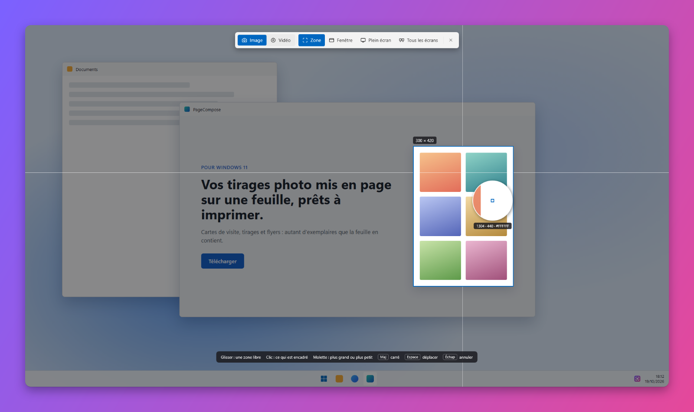
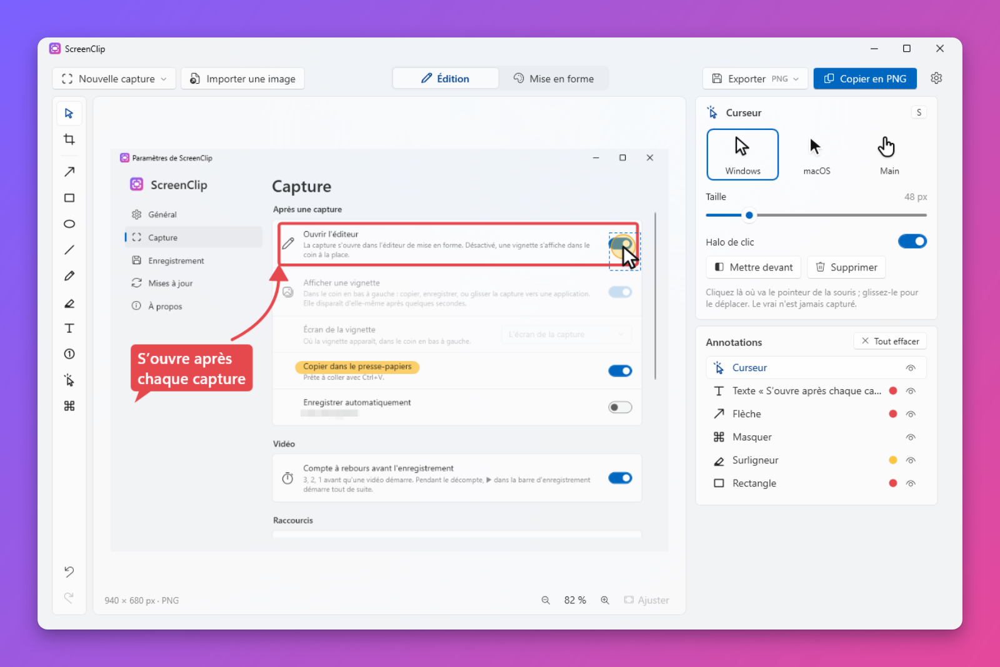

<p align="center">
  
</p>

<h1 align="center">ScreenClip</h1>

<p align="center">
  Des captures d'écran pour Windows 11, prêtes à partager : une touche, des flèches et du texte si besoin, puis une
  jolie mise en forme autour (fond, cadre de fenêtre, coins arrondis, ombre).
</p>

<p align="center">
  <a href="README.md">English</a> · <b>Français</b>
</p>

<p align="center">
  
</p>

---

> **Début du développement.** La version 0.2 capture, annote et met en forme les captures d'écran ; l'enregistrement
> vidéo arrive avec la prochaine version.

## Fonctionnalités

### Capture

- **Impr. écran** capture une zone, **Alt + Impr. écran** une fenêtre, **Ctrl + Impr. écran** l'écran entier,
  **Ctrl + Maj + Impr. écran** tous les écrans d'un coup, **Maj + Impr. écran** refait la dernière zone. Chaque raccourci se modifie dans **Paramètres → Capture**, ou tous
  se désactivent (le menu de la zone de notification capture toujours).
- ScreenClip attend dans la **zone de notification** : un **clic** sur son icône capture une zone (ou ouvre le menu
  ou l'éditeur, au choix dans **Paramètres → Général**), un **clic droit** ouvre son menu (les mêmes captures, le
  dossier des captures et les paramètres). Au repos il ne consomme presque rien : aucune fenêtre, aucun minuteur,
  environ 5 Mo de mémoire utilisée.
- L'écran est **figé** à l'instant où la touche est pressée : menus et info-bulles restent sur l'image.
- **Zone** : la partie de la fenêtre sous le pointeur est **encadrée** au survol (un lecteur vidéo, une carte d'une
  page web, un panneau, la fenêtre entière), d'après ce que l'application indique à Windows et les blocs dessinés à
  l'écran : un **clic** la prend, la **molette** passe à une partie plus grande ou plus petite. Ou glissez un
  rectangle. Une **loupe** montre les pixels sous le pointeur (avec leur position et leur couleur), et la taille
  s'affiche pendant le tracé.
  **Maj** fait un carré, **Espace** déplace la zone, **clic droit** ou **Échap** recommence ou annule.
- **Fenêtre** : la fenêtre sous le pointeur est mise en évidence, un clic la prend.
- **Plein écran** : un clic prend l'écran sous le pointeur.
- **Tous les écrans** (avec plusieurs écrans) : pris tout de suite, en une image, depuis son bouton, son raccourci ou
  le menu ; là où il n'y a pas d'écran (écrans de tailles différentes), le PNG est transparent.
- Plusieurs écrans, chacun à sa propre échelle (100 %, 150 %…) : chaque pixel reste net.

<p align="center">
  
</p>

### Éditeur

Lancé depuis le menu Démarrer, ScreenClip ouvre son **éditeur** : une capture (ou n'importe quelle image : **Importer
une image**, la coller avec **Ctrl+V**, la glisser sur la fenêtre) est annotée et mise en forme en direct, comme les
captures des pages de présentation d'applications, des tutoriels et des posts de réseaux sociaux. Deux onglets,
**Édition** et **Mise en forme** (`Ctrl+1` / `Ctrl+2`) : les deux copient et enregistrent la même image, annotations
et mise en forme comprises.

**Édition** : les outils en colonne à gauche, chacun avec sa lettre, et leurs options à droite.

- **Flèche** (`A` : simple, double, ou courbe avec une poignée pour la courber), **rectangle** (`R`) et **ellipse**
  (`O`) : contour, plein, ou un **spot** qui assombrit le reste de la capture ; **ligne** (`L`), **stylo** (`P`),
  **surligneur** (`H`), **texte** (`T` : seul, sur une étiquette ou dans une bulle), **étapes numérotées** (`N` : 1, 2,
  3…).
- Un **pointeur de souris** (`S`) : Windows, macOS ou une main, à la taille voulue, avec un **halo de clic** jaune. Le
  vrai pointeur n'est jamais dans les captures : celui-ci va exactement où il faut.
- **Masquer** (`B`) ce qui ne doit pas se voir : pixeliser, flouter, ou un pavé (le seul qui ne laisse rien deviner).
- **Recadrer** (`C`) : glissez les bords ou les coins ; **Toute la capture** rend tout.
- Huit couleurs, trois épaisseurs ou tailles ; **Maj** garde des pas de 45°, des carrés et des cercles.
- Tout reste modifiable : **sélectionnez** (`V`) une annotation pour la déplacer, la remodeler avec ses poignées,
  changer ses options, la mettre devant ou la supprimer (`Suppr`) ; la liste à droite les montre toutes. **Ctrl+Z** /
  **Ctrl+Y** annulent et rétablissent.
- **Zoom** en bas à droite, ou **Ctrl + molette** autour du pointeur (jusqu'à 800 %, les pixels restent nets) ;
  **Ajuster** remontre toute l'image (`Ctrl+0`). Zoomée, la molette fait défiler (Maj : en largeur), et le bouton du
  milieu ou **Espace + glisser** déplace l'image.

<p align="center">
  
</p>

**Mise en forme** :

- Des **préréglages** en un clic, chacun dessiné tel qu'il rend : *Neutre* (par défaut : juste l'image sur le fond de
  votre choix, ni cadre, ni coins, ni ombre, ni contour), *README* (clair, discret), *Post 1:1*, *Story 9:16*,
  *Slide 16:9*, et **les vôtres** : **+ Enregistrer** garde le style actuel sous un nom (son image de fond comprise) ;
  un clic droit sur l'un d'eux le renomme, le remplace par le style actuel ou le supprime. **Réinitialiser** revient
  à *Neutre*, en gardant le fond. Les derniers réglages utilisés sont gardés pour la capture suivante.
- **Fond** : huit dégradés, blanc, noir, transparent, la capture elle-même floutée, ou **votre propre image**.
- **Cadre** : aucun, un **navigateur façon macOS** (feux tricolores et une adresse que vous tapez), une **fenêtre
  macOS**, une **fenêtre Windows 11** (avec un titre que vous tapez), clair ou sombre, chacun avec les coins arrondis
  de la vraie fenêtre (8 px pour Windows 11, 10 pour macOS ; le curseur les change toujours) ; ou un appareil, un
  **ordinateur portable** ou un **téléphone**, argent ou graphite (le téléphone se met à l'horizontale pour une capture
  large). Sans aucune marque. Leur écran garde la forme d'un vrai : une capture d'une autre forme est recadrée (une
  longue page garde son haut).
- **Marge**, **coins arrondis** et **ombre** (curseurs), une **inclinaison 3D** (à gauche ou à droite en un clic, ou
  à la main : gauche–droite et haut–bas), et le **format** : auto, 16:9, 4:3, 1:1, 4:5 ou 9:16.
- La capture garde ses propres pixels : l'image grandit autour d'elle, rien n'est redimensionné. Les grandes captures
  (écrans haute densité) ont une barre de fenêtre et des coins plus grands, pour qu'un style rende pareil sur toutes.
- **Copier** (PNG avec sa transparence, et une image pour les autres applications), **Enregistrer** en PNG, JPG ou
  WebP (dans `Images\ScreenClip`, à part des captures ; modifiable), ou **glisser l'aperçu** vers une application ou
  un dossier. Une fois un fichier écrit (Enregistrer, ou une capture enregistrée automatiquement), une notification en
  bas à gauche l'ouvre ou l'affiche dans son dossier.
- **Nouvelle capture** depuis l'éditeur : il s'efface le temps de choisir, et revient avec la capture.

### Vidéo

- **Ctrl + Alt + Impr. écran** (ou **Vidéo** dans la barre de capture, ou le menu de l'icône) : choisissez une zone,
  une fenêtre ou un écran comme pour une image, et l'enregistrement démarre après un compte à rebours de 3 secondes.
  Le **son de l'ordinateur** et le **micro** s'activent ou se coupent chacun dans la barre de capture.
- Pendant l'enregistrement, un trait rouge pointillé entoure la zone et une petite barre montre la durée :
  **pause**, **arrêter**, **recommencer**, **abandonner**. Ni l'un ni l'autre n'est jamais dans la vidéo. Le même
  raccourci, ou un clic sur l'icône, l'arrête aussi.
- La vidéo s'ouvre dans l'**éditeur** : lisez-la (**Espace**), coupez son début et sa fin avec les **poignées jaunes**
  de la timeline, recadrez-la, annotez-la et mettez-la en forme comme une image (tout s'applique à chaque image).
  **Enregistrer** écrit un **MP4** (avec le son) ou un **GIF** animé (léger, sans son), ou une image de l'instant
  montré ; **Copier** met le MP4 dans le presse-papiers, prêt à coller dans un dossier, un mail ou une discussion.
- Enregistrée automatiquement quand les captures le sont, dans **Vidéos\Enregistrements d'écran** (modifiable).

### La touche Impr. écran de Windows

Windows 11 garde la touche **Impr. écran** pour son Outil Capture. Au premier lancement, ScreenClip propose de changer
ce réglage de Windows pour vous (*Paramètres › Accessibilité › Clavier › Utiliser la touche Impr. écran pour ouvrir
la capture d'écran*, pour votre compte seulement, sans droits d'administrateur). **Paramètres → Capture** permet de
rendre la touche à Windows à tout moment, et la désinstallation de ScreenClip la lui rend aussi. Windows n'applique
parfois le changement qu'à la prochaine ouverture de session.

### Après une capture

- La capture **s'ouvre dans l'éditeur**, prête à mettre en forme (activé par défaut ; **Paramètres → Capture**).
- Ou, l'éditeur désactivé, une **vignette** dans le coin en bas à gauche de l'écran de la capture, de l'écran
  principal ou de celui du pointeur (au choix dans **Paramètres → Capture** ; les notifications de Windows sont à
  droite) : **Copier**, **Enregistrer**, **Mettre en forme** (l'ouvre dans l'éditeur), l'**épingler** pour qu'elle
  reste, ou la **glisser** dans une application (mail, messagerie, Word, un dossier…), qui reçoit le fichier image.
  Elle disparaît d'elle-même après quelques secondes, ne prend jamais le clavier à l'application en cours et
  n'apparaît jamais dans les captures suivantes.
- La capture est **copiée** dans le presse-papiers (image et PNG), et peut être **enregistrée automatiquement** :
  fichiers PNG dans le dossier **Captures d'écran** de Windows (`Images\Captures d'écran`, là où Win + Impr. écran et
  l'Outil Capture enregistrent), nommés `Capture 2026-10-19 à 18.12.05.png` (dossier et nom modifiables).

### Et aussi

- Apparence Windows 11 (Fluent, Mica) qui **suit le thème clair/sombre** de Windows ; le thème peut aussi être forcé
  dans les **Paramètres**.
- **Anglais et français**, selon la langue d'affichage de Windows ou au choix dans les **Paramètres**.
- **Démarre avec Windows** (désactivable dans les paramètres).
- **Mises à jour en un clic** : au démarrage, l'application consulte les Releases GitHub et propose la nouvelle
  version dans les paramètres, qui s'installe et relance l'application. Canal **Bêta** disponible.
- **Mode développeur** (Paramètres → À propos) : la vignette et la barre d'enregistrement restent visibles dans les
  captures d'écran, et un journal note ce que fait ScreenClip (jamais ce que montrent les captures), à envoyer quand
  quelque chose ne marche pas.

### Raccourcis

| Action | Raccourci |
|--------|-----------|
| Capturer une zone | `Impr. écran` |
| Capturer une fenêtre | `Alt` + `Impr. écran` |
| Capturer l'écran entier | `Ctrl` + `Impr. écran` |
| Capturer tous les écrans | `Ctrl` + `Maj` + `Impr. écran` |
| Refaire la dernière zone | `Maj` + `Impr. écran` |
| Enregistrer une vidéo / l'arrêter | `Ctrl` + `Alt` + `Impr. écran` |
| Pendant la sélection : carré / déplacer / annuler | `Maj` / `Espace` / `Échap` ou clic droit |
| Éditeur : importer / coller / copier / enregistrer | `Ctrl+O` / `Ctrl+V` / `Ctrl+C` / `Ctrl+S` |
| Éditeur : onglet Édition / Mise en forme | `Ctrl+1` / `Ctrl+2` |
| Éditeur : annuler / rétablir | `Ctrl+Z` / `Ctrl+Y` |
| Édition : zoom / ajuster | `Ctrl` + molette, `Ctrl++` / `Ctrl+-` / `Ctrl+0` |
| Une vidéo : lire / pause | `Espace` |
| Édition : sélectionner, recadrer, flèche, rectangle, ellipse, ligne, stylo, surligneur, texte, numéro, curseur, masquer | `V` `C` `A` `R` `O` `L` `P` `H` `T` `N` `S` `B` |

### À venir

- [x] Éditeur de mise en forme, fausses fenêtres, ordinateur portable et téléphone.
- [x] Vos propres préréglages enregistrés.
- [x] Annotations : flèches, formes, texte, étapes numérotées, surligneur, pointeur de souris, masquage, recadrage.
- [x] Vidéo : une zone, une fenêtre ou un écran, avec le son de l'ordinateur et le micro ; couper, recadrer, annoter,
  mettre en forme ; MP4 ou GIF.
- [ ] Vidéo, ensuite : des annotations qui apparaissent et disparaissent sur la timeline, le pointeur redessiné, des
  effets de clic, un pointeur animé.

## Installation

1. Téléchargez `ScreenClip-Setup-x.y.z.exe` depuis la page [Releases](../../releases).
2. Lancez-le. L'installeur n'étant pas signé, Windows SmartScreen peut afficher « Windows a protégé votre ordinateur » :
   cliquez sur **Informations complémentaires → Exécuter quand même**.
3. Acceptez la demande d'administrateur (UAC).

L'installeur :

- copie l'application dans `C:\Program Files\ScreenClip` et l'ajoute au menu Démarrer (raccourci sur le bureau en
  option) ;
- propose d'installer le **.NET 10 Desktop Runtime** de Microsoft s'il est absent.

À son premier lancement, l'application active *Démarrer avec Windows* (Paramètres → Général), pose la question de la
touche Impr. écran, puis ouvre l'éditeur.

Mettre à jour : l'application propose elle-même les nouvelles versions (**Paramètres → Mises à jour**, et un bandeau
en haut des paramètres). Le nouvel installeur est téléchargé depuis GitHub, vérifié avec le SHA-256 publié par GitHub,
installé sans fenêtre, puis ScreenClip redémarre.

Désinstaller : **Paramètres → Applications → Applications installées → ScreenClip**. La désinstallation ferme
ScreenClip, retire l'application, son démarrage avec Windows et ses fichiers temporaires, rend la touche Impr. écran à
l'Outil Capture si ScreenClip l'avait prise, et demande s'il faut aussi supprimer vos réglages (Non par défaut). Vos
captures ne sont jamais supprimées.

**Configuration requise :** Windows 10 2004 ou plus récent, x64 (conçu pour Windows 11).

## Développement

### Prérequis

Tout s'installe avec `winget` (intégré à Windows 11), depuis un terminal :

| Outil | Rôle | Installation |
|-------|------|--------------|
| **Git** | Récupérer le code | `winget install Git.Git` |
| **.NET 10 SDK** | Compiler l'application (C# / WPF) et lancer les tests | `winget install Microsoft.DotNet.SDK.10` |
| **Inno Setup 6** | Construire l'installeur | `winget install JRSoftware.InnoSetup` |

N'importe quel éditeur (Visual Studio, VS Code, Rider) convient pour le code C#.

### Compiler

```powershell
.\scripts\build.ps1
```

Le script lance les tests, puis produit dans `dist\` :

| Fichier | Contenu |
|---------|---------|
| `app\` | l'application (`ScreenClip.exe`…), dépendante du runtime .NET, précompilée (ReadyToRun) |
| `ScreenClip-Setup-<version>.exe` | l'installeur |

Options : `-SkipTests`, `-NoInstaller`.

### Pendant le développement

```powershell
dotnet test tests\ScreenClip.Tests        # tests unitaires
dotnet run --project src\ScreenClip       # lance l'application (elle ouvre l'éditeur ; --background n'ouvre rien)
```

Définissez `SCREENCLIP_LANG` à `en` ou `fr`, ou `SCREENCLIP_THEME` à `Light` ou `Dark`, avant de lancer l'application
pour voir l'autre langue ou l'autre thème sans changer de réglage. `SCREENCLIP_CAPTURABLE=1` laisse les vignettes
apparaître dans les captures d'écran (elles en sont normalement exclues, pour ne jamais se retrouver dans la capture
suivante), comme le mode développeur. `SCREENCLIP_TRACE=1` écrit ce que le mode Zone trouve sous le pointeur dans `%TEMP%\ScreenClip-trace.txt`.
`SCREENCLIP_DEMO_SCREEN=<image>` fait figer cette image au lieu de l'écran lors d'une capture (pour les images du
README). ScreenClip ne tourne qu'une fois par session : quittez-le depuis son menu de notification avant d'en
lancer une autre version.

### Organisation du code

```
src/
  ScreenClip.Core/    Logique sans interface : raccourcis (Hotkey), géométrie de la sélection, noms de fichiers,
                      réglage Impr. écran de Windows, liste des releases GitHub (mises à jour), Annotations/ : les
                      annotations (modèle, sélection, dessin, annulation), et Composition/ : la mise en forme d'une
                      capture (styles, fonds, tailles, inclinaison 3D) dessinée avec SkiaSharp, export PNG / JPG / WebP
  ScreenClip/         Application WPF : icône de notification et raccourcis globaux (TrayHost), capture de l'écran
                      (GDI), écran de sélection (avec les éléments sous le pointeur, par UI Automation), vignette,
                      éditeur (onglets Édition et Mise en forme), paramètres, mises à jour, textes de l'interface
installer/            Script Inno Setup de l'installeur
scripts/              build.ps1 (compilation complète), make-icons.ps1 (régénère les icônes)
tests/                Tests unitaires (xUnit)
docs/                 Icône du README, icône SVG (docs/icons)
.github/workflows/    Compilation automatique sur GitHub (et publication des releases)
```

### Traductions

| Quoi | Où |
|------|----|
| Textes de l'application | `src/ScreenClip/Properties/Strings.resx` (anglais, par défaut) et `Strings.fr.resx` (français). Les tests vérifient que les deux ont les mêmes clés et les mêmes paramètres, et que chaque clé utilisée par le code existe. |
| Messages de l'installeur | `[Languages]` et `[CustomMessages]` dans `installer/ScreenClip.iss` |
| Langues proposées dans les paramètres | `AppSettings.SupportedLanguages` dans `src/ScreenClip/Services/AppSettings.cs` |

### Icônes

`scripts\make-icons.ps1` dessine l'icône (`src/ScreenClip/Assets/ScreenClip.ico`, son image de 256 px pour
l'application, et `docs/icon-256.png`) et une copie SVG (`docs/icons/ScreenClip.svg`) ; les petites tailles du `.ico`
sont ajustées au pixel près par le script. Les fichiers générés sont commités : ne relancez le script que pour changer
le dessin.

### Publier une version

1. Mettez à jour `<Version>` dans `Directory.Build.props`.
2. Commitez, puis créez et poussez un tag : `git tag v0.1.0`, puis `git push origin v0.1.0`.
3. Le workflow GitHub Actions compile, teste et publie l'installeur dans une Release.

Un tag avec un suffixe (`v0.2.0-beta.1`) est publié en *pré-version* : seules les applications réglées sur le canal
**Bêta** la proposent.

## Confidentialité

Vos captures ne quittent jamais votre ordinateur, sauf si vous les copiez, enregistrez ou glissez vous-même ailleurs.

Le seul accès réseau est la **recherche de mises à jour** : au démarrage (si *Rechercher les mises à jour au
démarrage* est activé, par défaut) et quand vous cliquez sur *Rechercher des mises à jour*, l'application envoie une
requête HTTPS à l'API GitHub (`api.github.com`) pour lire la liste des versions de ScreenClip. Aucune capture ni donnée
personnelle n'est envoyée ; comme pour toute requête web, GitHub voit votre adresse IP, et la version de l'application
dans le User-Agent. Quand vous acceptez une mise à jour, son installeur est téléchargé depuis GitHub. Désactivez la
recherche au démarrage dans **Paramètres → Mises à jour** et l'application ne fait plus aucune requête sans votre
demande.

## Licence

[MIT](LICENSE.md). Utilise [SkiaSharp](https://github.com/mono/SkiaSharp) (MIT).

## Crédits

Développé par [QuentinPerou](https://github.com/quentinperou), avec [Claude Code](https://claude.com/claude-code) (Anthropic).
