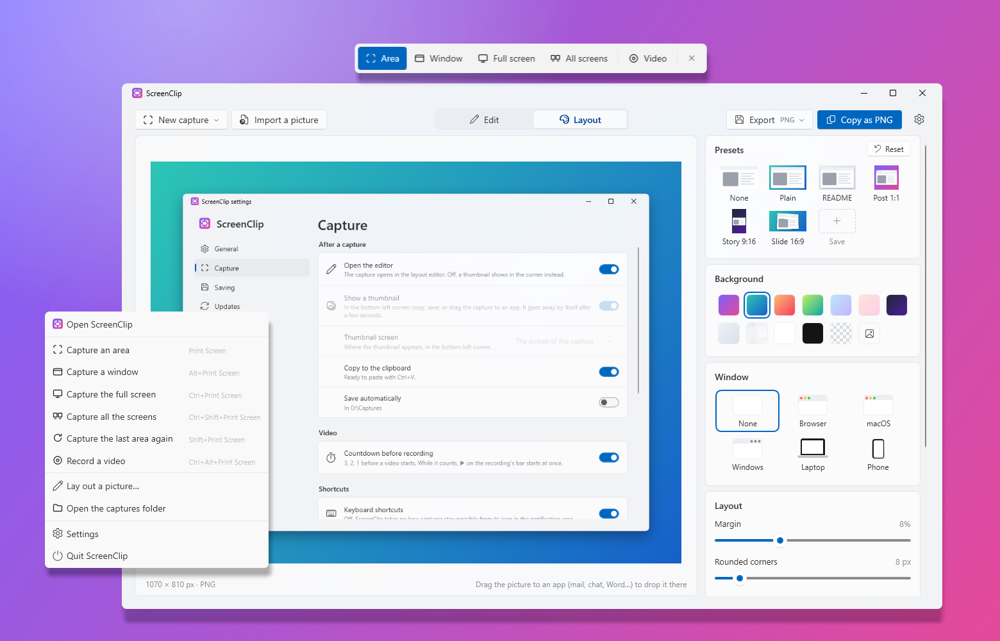
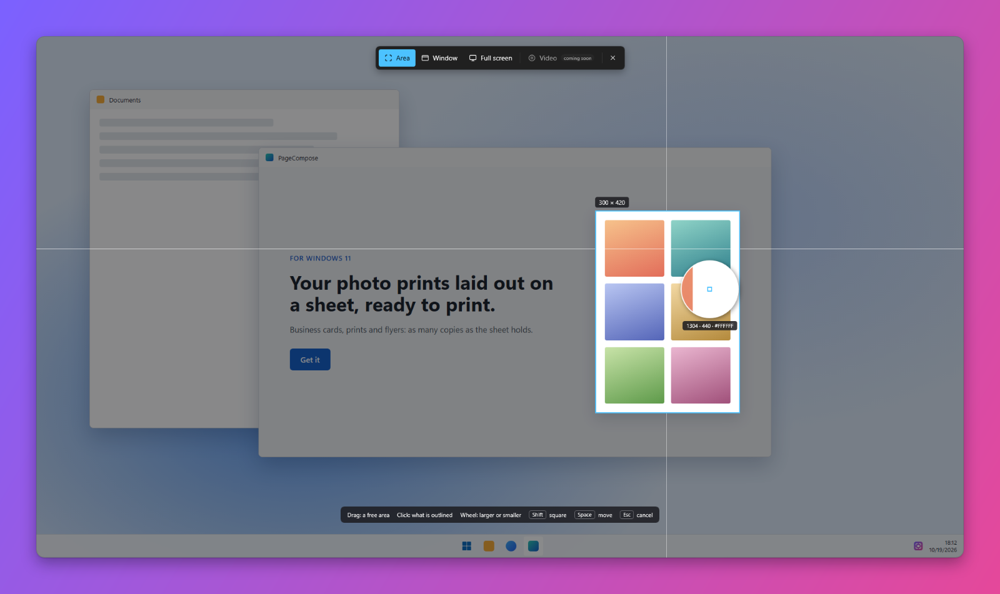

<p align="center">
  
</p>

<h1 align="center">ScreenClip</h1>

<p align="center">
  Screenshots for Windows 11, ready to share: one key, then a nice layout around them (background, window frame,
  rounded corners, shadow).
</p>

<p align="center">
  <b>English</b> · <a href="README.fr.md">Français</a>
</p>

<p align="center">
  
</p>

---

> **Early development.** Version 0.1 captures and lays out screenshots. Annotations and video capture will come
> after.

## Features

### Capture

- **Print Screen** captures an area, **Alt + Print Screen** a window, **Ctrl + Print Screen** the whole screen,
  **Shift + Print Screen** the last area again. Every shortcut can be changed in **Settings → Capture**, or all of
  them turned off (the notification menu still captures).
- ScreenClip waits in the **notification area**: a **click** on its icon captures an area (or opens the menu or the
  editor, as set in **Settings → General**), a **right click** opens its menu (the same captures, the captures folder,
  Settings). At rest it uses almost nothing: no window, no timer, about 5 MB of memory in use.
- The screen is **frozen** the moment the key is pressed: menus and tooltips stay in the picture.
- **Area**: the part of the window under the pointer is **outlined** as you move (a video player, a card of a web
  page, a panel, the whole window), from what the app tells Windows and from the blocks drawn on the screen: a
  **click** takes it, the **mouse wheel** goes to a larger or smaller part. Or drag a rectangle. A **magnifier** shows
  the pixels under the pointer (with their position and color), and the size is shown as you drag.
  **Shift** makes a square, **Space** moves the area, **right click** or **Esc** starts again or cancels.
- **Window**: the window under the pointer is highlighted, a click takes it.
- **Full screen**: a click takes the screen under the pointer.
- Several monitors, each at its own scale (100 %, 150 %…): every pixel stays sharp.

<p align="center">
  
</p>

### Layout editor

Started from the Start menu, ScreenClip opens its **editor**: a capture (or any picture: **Import a picture**, paste
it with **Ctrl+V**, drop it on the window) is laid out live, the way the screenshots of app pages and social posts
look.

- **Presets** in one click, each drawn as it renders: *README* (light, discreet), *Post 1:1*, *Story 9:16*,
  *Slide 16:9*, and **your own**: **+ Save** keeps the current style under a name (its picture background included);
  right click one to rename it, replace it with the current style or delete it. **Reset** goes back to the README one.
  The last settings used are kept for the next capture.
- **Background**: eight gradients, white, black, transparent, the capture itself blurred, or **your own picture**.
- **Frame**: none, a **browser in the macOS style** (traffic lights and an address you type), a **macOS window**, a
  **Windows 11 window** (with a title you type), light or dark, each with the rounded corners of the real one (8 px
  for Windows 11, 10 for macOS; the slider still changes them); or a device, a **laptop** or a **phone**, silver or
  graphite (the phone turns sideways for a wide capture). No brand on them. Their screen keeps the shape of a real
  one: a capture of another shape is cropped (a long page keeps its top).
- **Margin**, **rounded corners** and **shadow** (sliders), a **3D tilt** (left or right in one click, or by hand:
  left–right and up–down), and the **format**: auto, 16:9, 4:3, 1:1, 4:5 or 9:16.
- The capture keeps its own pixels: the picture grows around it, nothing is resized. Large (high DPI) captures get a
  larger window bar and corners, so that a style looks the same on any capture.
- **Copy** (PNG with its transparency, and a bitmap for the other apps), **Save** as PNG, JPG or WebP (in
  `Pictures\ScreenClip`, apart from the captures; can be changed), or **drag the preview** to an app or a folder.
- **New capture** from the editor: it steps aside while you choose, and comes back with the capture.

### Windows' Print Screen key

Windows 11 keeps the **Print Screen** key for its Snipping Tool. At the first start, ScreenClip offers to change that
Windows setting for you (*Settings › Accessibility › Keyboard › Use the Print screen key to open screen capture*, for
your account only, no administrator rights). **Settings → Capture** can give the key back to Windows at any time, and
uninstalling ScreenClip gives it back too. Windows sometimes only applies the change at the next sign-in.

### After a capture

- A **thumbnail** in the bottom left corner of the screen of the capture, the main screen or the pointer's (as set in
  **Settings → Capture**; Windows' notifications are on the right): **Copy**, **Save**, **Lay out** (opens it in the
  editor), **pin** it so that it stays, or **drag it** into an app (mail, chat, Word, a folder…), which receives the
  image file. It goes away by itself after a few seconds, never takes the keyboard from the app you are in, and never
  appears in the next captures.
- The capture is **copied** to the clipboard (bitmap and PNG), and can be **saved automatically**: PNG files in the
  **Screenshots** folder of Windows (`Pictures\Screenshots`, where Win + Print Screen and the Snipping Tool save),
  named `Screenshot 2026-10-19 at 18.12.05.png` (folder and name can be changed).

### And also

- Windows 11 look (Fluent, Mica) that **follows the light/dark theme** of Windows; the theme can also be set to
  light or dark in **Settings**.
- **English and French**, following the Windows display language or chosen in **Settings**.
- **Starts with Windows** (can be turned off in Settings).
- **Updates in one click**: at startup the app checks the GitHub Releases and offers the new version in Settings,
  which installs itself and restarts the app. **Beta** channel available.

### Shortcuts

| Action | Shortcut |
|--------|----------|
| Capture an area | `Print Screen` |
| Capture a window | `Alt` + `Print Screen` |
| Capture the full screen | `Ctrl` + `Print Screen` |
| Capture the last area again | `Shift` + `Print Screen` |
| While selecting: square / move / cancel | `Shift` / `Space` / `Esc` or right click |
| Editor: import / paste / copy / save | `Ctrl+O` / `Ctrl+V` / `Ctrl+C` / `Ctrl+S` |

### Coming next

- [x] Layout editor, fake windows, laptop and phone.
- [ ] Your own saved presets.
- [ ] Annotations (arrows, text, blur, numbered steps), video / GIF capture.

## Installation

1. Download `ScreenClip-Setup-x.y.z.exe` from the [Releases](../../releases) page.
2. Run it. As the installer is not signed, Windows SmartScreen may show “Windows protected your PC”:
   click **More info → Run anyway**.
3. Accept the administrator prompt (UAC).

The installer:

- copies the app to `C:\Program Files\ScreenClip` and adds it to the Start menu (desktop shortcut optional);
- offers to install the Microsoft **.NET 10 Desktop Runtime** if it is missing.

At its first start the app turns on *Start with Windows* (Settings → General), asks about the Print Screen key, then
opens the editor.

To update: the app offers new versions itself (**Settings → Updates**, and a bar at the top of Settings). The new
installer is downloaded from GitHub, checked against the SHA-256 published by GitHub, installed silently, and
ScreenClip starts again.

To uninstall: **Settings → Apps → Installed apps → ScreenClip**. The uninstaller closes ScreenClip, removes the app,
its start with Windows and its temporary files, gives the Print Screen key back to the Snipping Tool if ScreenClip had
taken it, and asks whether to delete your settings too (No by default). Your captures are never deleted.

**Requirements:** Windows 10 2004 or later, x64 (made for Windows 11).

## Development

### Prerequisites

Everything installs with `winget` (built into Windows 11), from a terminal:

| Tool | Purpose | Install |
|------|---------|---------|
| **Git** | Get the code | `winget install Git.Git` |
| **.NET 10 SDK** | Build the app (C# / WPF) and run the tests | `winget install Microsoft.DotNet.SDK.10` |
| **Inno Setup 6** | Build the installer | `winget install JRSoftware.InnoSetup` |

Any editor (Visual Studio, VS Code, Rider) is fine for the C# code.

### Build

```powershell
.\scripts\build.ps1
```

The script runs the tests, then produces in `dist\`:

| File | Content |
|------|---------|
| `app\` | the app (`ScreenClip.exe`…), framework-dependent, compiled ahead of time (ReadyToRun) |
| `ScreenClip-Setup-<version>.exe` | the installer |

Options: `-SkipTests`, `-NoInstaller`.

### While developing

```powershell
dotnet test tests\ScreenClip.Tests        # unit tests
dotnet run --project src\ScreenClip       # run the app (it opens the editor; --background opens nothing)
```

Set `SCREENCLIP_LANG` to `en` or `fr`, or `SCREENCLIP_THEME` to `Light` or `Dark`, before starting the app to check
the other language or theme without changing any setting. `SCREENCLIP_CAPTURABLE=1` leaves the thumbnails in
screenshots (they are normally excluded, so that they never show in the next capture). `SCREENCLIP_TRACE=1` writes
what the Area mode finds under the pointer to `%TEMP%\ScreenClip-trace.txt`. `SCREENCLIP_DEMO_SCREEN=<picture>`
makes a capture freeze that picture instead of the screen (for the README pictures). ScreenClip runs once per
session: quit it from its notification menu before starting another build.

### Code layout

```
src/
  ScreenClip.Core/    Logic without UI: shortcuts (Hotkey), area selection geometry, file names, the Print Screen
                      setting of Windows, list of the GitHub releases (updates), and Composition/: the layout of a
                      capture (styles, backgrounds, sizes, 3D tilt) drawn with SkiaSharp, PNG / JPG / WebP export
  ScreenClip/         WPF app: notification icon and global shortcuts (TrayHost), screen capture (GDI), selection
                      overlay (with the elements under the pointer, from UI Automation), thumbnail, layout editor,
                      settings, updates, UI strings
installer/            Inno Setup script of the installer
scripts/              build.ps1 (full build), make-icons.ps1 (regenerates the icons)
tests/                Unit tests (xUnit)
docs/                 README icon, SVG icon (docs/icons)
.github/workflows/    Automated build on GitHub (and release publishing)
```

### Translations

| What | Where |
|------|-------|
| App texts | `src/ScreenClip/Properties/Strings.resx` (English, the default) and `Strings.fr.resx` (French). The tests check that both have the same keys and placeholders, and that every key used by the code exists. |
| Installer messages | `[Languages]` and `[CustomMessages]` in `installer/ScreenClip.iss` |
| Languages offered in Settings | `AppSettings.SupportedLanguages` in `src/ScreenClip/Services/AppSettings.cs` |

### Icons

`scripts\make-icons.ps1` draws the icon (`src/ScreenClip/Assets/ScreenClip.ico`, its 256 px image for the app, and
`docs/icon-256.png`) and an SVG copy of it (`docs/icons/ScreenClip.svg`); the small sizes of the `.ico` are fitted to
whole pixels by the script. The generated files are committed: run it again only to change the design.

### Releasing a version

1. Update `<Version>` in `Directory.Build.props`.
2. Commit, then create and push a tag: `git tag v0.1.0`, then `git push origin v0.1.0`.
3. The GitHub Actions workflow builds, tests and publishes the installer in a Release.

A tag with a suffix (`v0.2.0-beta.1`) is published as a *pre-release*: only the apps set to the **Beta** update channel
offer it.

## Privacy policy

Your captures never leave your computer unless you copy, save or drag them somewhere yourself.

The only network access is the **update check**: when the app starts (if *Check for updates at startup* is on, the
default) and when you click *Check for updates*, it sends one HTTPS request to the GitHub API (`api.github.com`) to
read the list of ScreenClip releases. No capture or personal data is sent; like any web request, GitHub sees your IP
address, and the app version in the User-Agent. When you accept an update, its installer is downloaded from GitHub.
Turn off the check at startup in **Settings → Updates** and the app makes no request unless you ask for one.

## License

[MIT](LICENSE.md). Uses [SkiaSharp](https://github.com/mono/SkiaSharp) (MIT).

## Credits

Developed by [QuentinPerou](https://github.com/quentinperou), with [Claude Code](https://claude.com/claude-code) (Anthropic).
